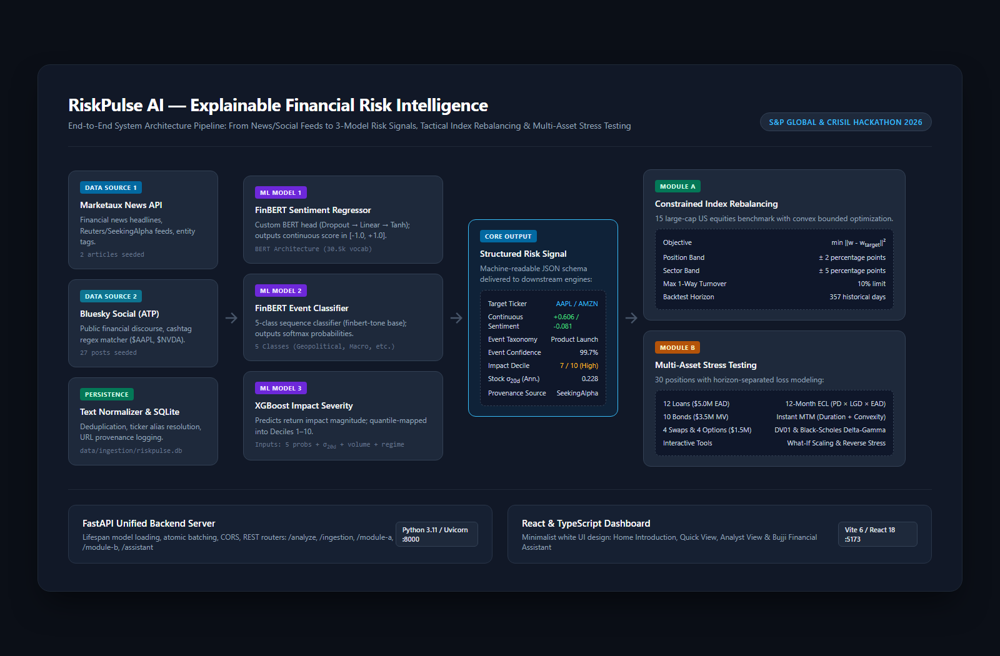

# RiskPulse AI — Explainable Financial Risk Intelligence

**S&P Global & CRISIL Campus Hackathon 2026**

[](https://www.python.org/)
[](https://nodejs.org/)
[](https://fastapi.tiangolo.com/)
[](https://react.dev/)
[](LICENSE)

> **Reproducibility notice (October 2026):** The event-classifier and sentiment-regressor checkpoint weights are not tracked in this repository. A fresh clone cannot run full real NLP inference until those authentic checkpoints are provided. The recorded event-model result (accuracy 0.99457; macro-F1 0.97976) comes from the original notebook, **not a model rerun in this repository review**. Its training initialization differs from the committed runtime event-model configuration; see [event-classifier provenance](training/event_classifier/README.md). Recorded software verification is documented separately in [validation](docs/validation.md). Do not interpret example portfolio outputs as real-world investment performance.

---

## 1. Project Overview / Problem Statement & Approach

Financial institutions, investment managers, and risk analysts face an overwhelming influx of unstructured textual information across earnings announcements, regulatory filings, financial journalism, and social discourse. Traditional quantitative risk models rely predominantly on structured historical market data (such as closing prices and corporate fundamentals), often reacting to material corporate events only after significant market price discovery has already taken place. Conversely, qualitative research remains manual, labor-intensive, and difficult to scale across thousands of instruments.

**RiskPulse AI** bridges this critical divide by converting unstructured financial textual narratives into interpretable, machine-readable quantitative risk signals and applying them directly to real-world financial decision workflows. Rather than treating sentiment as an isolated scalar metric, RiskPulse AI combines multi-dimensional natural language processing with gradient-boosted decision trees to evaluate event taxonomy classification, continuous sentiment intensity, and market impact severity deciles.

The structured risk signals produced by the engine are connected downstream to two distinct institutional risk laboratories: **Module A (Index Rebalancing)**, which translates event sentiment into constraint-aware portfolio tilts with quadratic distance minimization subject to turnover and concentration limits; and **Module B (Multi-Asset Stress Testing)**, which maps adverse event scenarios onto a 30-position institutional balance sheet while rigorously separating trading book mark-to-market re-pricing from banking book 12-month expected credit loss provisioning.

### Core Problem Requirements vs. Implemented Extensions

| Dimension | Core Hackathon Challenge Requirements | RiskPulse AI Implemented Extensions |
|---|---|---|
| **Data Ingestion** | Multiple unstructured information sources | **Dual-source ingestion pipeline (live APIs optional):** Marketaux Financial News API + Bluesky Social (AT Protocol) with text normalization, ticker regex extraction, entity aliasing, and SQLite persistence. |
| **Sentiment Analysis** | Sentiment score extraction | **FinBERT Continuous Regressor:** BERT regression architecture (`FinBertSentimentRegressor`) with linear projection and Tanh activation outputting continuous sentiment intensity $\hat{s} \in [-1.0, +1.0]$. |
| **Event Classification** | Financial event classification | **Five-class financial event classifier (checkpoint provenance under review):** 5-class financial event taxonomy (`Geopolitical`, `Macroeconomic`, `Credit Event`, `Merger / Acquisition`, `Product Launch`) with softmax probability distributions. Runtime configuration references `yiyanghkust/finbert-tone`; the recorded fine-tuning notebook initializes a different base checkpoint. The provenance discrepancy must be resolved before claiming the currently deployed weights reproduce the notebook results. |
| **Impact Severity** | Impact severity estimation | **XGBoost Severity Engine:** Gradient-boosted decision trees predicting market reaction decile ($1 \dots 10$) conditional on continuous sentiment, 5 event probabilities, 20-day rolling volatility, 20-day volume ratio, returns, and sector/regime features. |
| **Output Schema** | Machine-readable results | **Standardized JSON Schema:** Standardized risk signal payloads detailing ticker, confidence, category, decile severity, sentiment intensity, and provenance URL. |
| **Downstream Applications** | At least one financial portfolio application | **Two institutional modules:**<br>• **Module A:** 15-stock constrained quadratic index optimization with 357-day historical walk-forward backtesting.<br>• **Module B:** 30-position multi-asset stress laboratory with What-If exposure adjustment and bisection reverse stress testing. |
| **Explainability & UX** | Reviewer-ready interface | **Modern Clean White UI:** Dual view modes (Quick View for executive screening, Analyst View for quantitative audit) + **Bujji**, an interactive conversational assistant for explaining financial models and risk metrics. |

---

## 2. Architecture & Technology Stack

### System Architecture Pipeline

The end-to-end data flow operates through four coordinated stages:

```
Financial News / Public Social Media
                  ↓
Text Normalization & SQLite Event Storage (data/ingestion/riskpulse.db)
                  ↓
Three-Stage Machine Learning Risk Engine:
  ├── 1. FinBERT Sentiment Regressor (Continuous [-1.0, +1.0], Tanh-bounded)
  ├── 2. FinBERT Event Classifier (5-Class Softmax Taxonomy)
  └── 3. XGBoost Impact Severity (Decile 1–10 with 20-Day Volatility & Sector Features)
                  ↓
Structured Risk Signal (JSON Schema)
                  ↓
Downstream Financial Applications:
  ├── Module A: Constrained Quadratic Index Rebalancing (15 Equities)
  └── Module B: Multi-Asset Stress Laboratory (30 Positions: MTM vs. ECL)
                  ↓
FastAPI Unified Backend Server (Python 3.11 / Uvicorn :8000)
                  ↓
React & TypeScript Dashboard (Vite 6 / React 19 :5173)
```



### Architectural Components

1. **Ingestion Layer (Deterministic Heuristics & APIs):**
   - `Marketaux News Adapter`: Queries financial news publications, extracts article titles, snippets, entities, and publication timestamps.
   - `Bluesky Social Adapter`: Uses the decentralized AT Protocol to stream public financial discourse matching equity cashtags (`$AAPL`, `$NVDA`, etc.).
   - `Text Normalizer & SQLite Repository`: Strips boilerplate, deduplicates via URL hashing, resolves ticker aliases (e.g., "Google" $\rightarrow$ `GOOGL`), and persists raw records into `data/ingestion/riskpulse.db`.
2. **Three-Stage ML Risk Engine (Trained Machine Learning Models):**
   - **Model 1 (FinBERT Sentiment):** Custom BERT regression head (`Dropout -> Linear -> Tanh`) outputting continuous sentiment intensity $\hat{s} \in [-1.0, +1.0]$ trained with MSE loss.
   - **Model 2 (FinBERT Event Classifier):** Evaluates multi-class sequence probabilities across 5 financial event categories (`Geopolitical`, `Macroeconomic`, `Credit Event`, `Merger / Acquisition`, `Product Launch`). Pretrained base configuration references `yiyanghkust/finbert-tone`.
   - **Model 3 (XGBoost Impact Severity):** Combines continuous sentiment, 5 event probabilities, event confidence, historical 20-day annualized rolling price volatility ($\sigma_{20\text{d}}$), 20-day volume ratio, return momentum, and one-hot sector indicators to predict market severity decile ($1 \dots 10$).
3. **Module A — Index Rebalancing Laboratory (Constrained Convex Optimization):**
   - Formulates a quadratic optimization problem minimizing squared Euclidean distance from the signal-tilted target allocation.
   - Enforces strict institutional constraints: full investment ($\sum w_i = 1.0$), long-only ($w_i \ge 0$), position deviation limits ($\pm 2$ percentage points from benchmark), sector deviation limits ($\pm 5$ percentage points from baseline), and a 10% maximum one-way turnover budget, with transaction costs modeled at 10 basis points.
4. **Module B — Multi-Asset Stress Laboratory (Quantitative Financial Valuation):**
   - Evaluates a 30-position institutional reference portfolio (12 commercial loans, 10 corporate bonds, 4 interest rate swaps, 4 options).
   - Separates **Trading Book Mark-to-Market (MTM)** (second-order duration/rate convexity for bonds, signed DV01 curve re-pricing for swaps, full European Black-Scholes continuous dividend yield repricing for options) from **Banking Book Expected Credit Loss (ECL)** ($\Delta ECL = EAD \times (\text{PD}_{\text{stressed}} - \text{PD}_0) \times LGD$).
   - Provides interactive **What-If** position scaling and **Reverse Stress Testing** via bisection root-finding.
   - Explicitly preserves accounting integrity: Loan EAD ($5.0M), Bond MV ($3.5M), and Derivative Reference Notional ($1.5M) are distinct risk metrics and are **not** combined into Net Asset Value (NAV).
5. **API & Interface Layer:**
   - **FastAPI:** Lifespan model management, CORS middleware, Pydantic validation, atomic batch endpoints.
   - **React 19 + TypeScript + Vite:** Modern white minimalist design system, state synchronization across Quick View and Analyst View, responsive layout (mobile 390px to 1600px desktop).

---

## 3. Dataset Used

RiskPulse AI incorporates specific datasets across training, real-source ingestion, historical market prices, and portfolio stress modeling:

### 1. Model Training & Evaluation Data
- **Base Transformer Provenance:** Event classifier config references `yiyanghkust/finbert-tone` (Apache 2.0); sentiment regressor utilizes BERT-base architecture fine-tuned on financial text.
- **Sentiment Training:** The supplied sentiment notebooks use continuous FiQA sentiment scores and a FinBERT regression head. Original fine-tuned weights and processed splits are not committed; see `training/sentiment/`.
- **Event Taxonomy Training:** Six sourced collections are gathered and cleaned into five classes (`Geopolitical`, `Macroeconomic`, `Credit Event`, `Merger / Acquisition`, `Product Launch`). Recorded original notebook outputs show 26,172 raw candidate records and 16,576 cleaned real examples split as 13,260 train / 1,658 validation / 1,658 test. This training was **real-only**, not synthetic-augmented. See `training/event_classifier/README.md` and `recorded_results/notebook_evidence.json`.
- **Impact Severity Feature Matrix:** Calibrated on historical corporate event filings matched with subsequent 1-day and 3-day equity return quantiles to define decile impact boundaries (`configs/impact_decile_thresholds.json`).
- *Model availability:* Fine-tuned event and sentiment transformer weights are **not included**. The repository contains configs, tokenizers and the impact model, but those files alone cannot reproduce full NLP inference. Supply the authentic trained checkpoints from an authorized location and run `python -m scripts.check_models`. `SKIP_MODEL_LOAD=true` disables the real inference engine; it is **not** a mock that returns genuine risk predictions. Do not infer that a successful frontend build or unit test proves model inference.

### 2. Live Public News & Social Ingestion
- **Marketaux News API:** Real-time financial news headlines and metadata. Free-tier API token required for live fetching; 2 pre-collected news items are bundled in `data/ingestion/riskpulse.db`.
- **Bluesky Social Network (AT Protocol):** Public financial social media posts and commentary matching supported tickers; 27 pre-collected public posts are bundled in `data/ingestion/riskpulse.db`.
- *Copyright Compliance:* No full-text copyrighted news articles are stored or redistributed. The repository stores only headline metadata, snippets, ticker tags, and public canonical source URLs.

### 3. Historical Market Price Data
- **Historical Daily Prices:** Historical adjusted closing prices for the 15 supported equities retrieved via `yfinance` for 20-day volatility and volume calculations.
- **Offline Walk-Forward Holdout Data:** Bundled holdout market prices (`data/module_a/holdout_prices.csv`, 188 KB) and holdout signal series (`data/module_a/holdout_signals.csv`, 624 KB) covering 357 market sessions for offline reproducibility of Module A backtests without network access.

### 4. Synthetic Institutional Portfolio Data
- **Synthetic Institution Balance Sheet (`data/module_b/synthetic_portfolio.json`):** Calibrated 30-position institutional portfolio comprising 12 commercial loans ($5.0M EAD), 10 corporate bonds ($3.5M MV), 4 interest rate swaps ($1.0M Notional), and 4 options ($0.5M Reference Notional). Derivative reference notional ($1.5M) is non-additive.
- **Scenario Library (`data/module_b/scenario_library.json`):** 5 historical and hypothetical stress scenario families (Credit Event, Macroeconomic, Geopolitical, Merger / Acquisition, Product Launch) specifying quantitative shock vectors for risk-free rates, credit spreads, equity indices, FX rates, and loan default probabilities.

---

## 4. Quickstart & Installation

### Prerequisites
- **Python:** 3.11 or 3.12 (Tested on 3.11.9)
- **Node.js:** 20.x or later (Tested on Node 20.18)
- **Git:** 2.40+

### Step 1: Clone the Repository
```bash
git clone https://github.com/shanmukhdatta/nitj-shanmukhdatta-hackthon.git
cd nitj-shanmukhdatta-hackthon
```

### Step 2: Backend Setup
Create and activate a clean Python virtual environment:

```bash
# Windows (PowerShell)
python -m venv .venv
.venv\Scripts\Activate.ps1

# Linux / macOS
python3 -m venv .venv
source .venv/bin/activate
```

Install backend dependencies:
```bash
pip install -r requirements.txt
```

Set up environment variables:
```bash
# Copy example configuration template
cp .env.example .env
```
*Important:* The sample SQLite database contains pre-collected entries, but the default `SKIP_MODEL_LOAD=false` requires the genuine fine-tuned transformer weight files, which are **not bundled**. Without them the risk inference endpoints report HTTP 503. For UI inspection without weights, set `SKIP_MODEL_LOAD=true` in `.env`; the risk inference endpoints remain unavailable rather than producing fabricated scores. The included data and the independent downstream test scripts can still be inspected.

After placing both authentic NLP checkpoints in their configured model directories, verify file presence:
```bash
python -m scripts.check_models
```
This command will fail on a fresh clone until the omitted transformer weights are supplied. Passing it checks file presence, not full loading or checkpoint identity. For authorized Hugging Face model repositories, see `scripts/fetch_models.py`.

### Step 3: Frontend Setup
In a separate terminal, install dependencies:
```bash
cd frontend
npm install
cd ..
```

### Step 4: Launching the Application

**Terminal 1 — Backend Server:**
```bash
uvicorn app.main:app --reload --port 8000
```
- API Base URL: `http://127.0.0.1:8000`
- Interactive Swagger Documentation: `http://127.0.0.1:8000/docs`
- Health Endpoint: `http://127.0.0.1:8000/health`

**Terminal 2 — Frontend Application:**
```bash
npm --prefix frontend run dev
```
- Web Application: `http://127.0.0.1:5173`

### Step 5: Verification & Automated Tests
Execute the full test verification suite:

```bash
# 1. Run all 120 backend unit & integration tests
pytest -q

# 2. Run frontend unit tests (14 tests)
npm --prefix frontend test

# 3. Verify frontend-backend API contracts
npm --prefix frontend run check:contracts

# 4. Compile frontend production bundle
npm --prefix frontend run build

# 5. Run end-to-end integration audit (requires backend and frontend running)
node frontend/scripts/audit-e2e.mjs
```

---

## 5. Key Results & Domain Impact

The following table summarizes **previously recorded verification evidence**, not tests executed during this README revision. Distinguish software tests, illustrative example responses, and held-out model quality. Re-run the commands under Quickstart before claiming a fresh result:

### Verified Implementation Results

| Component | Verified Capability | Supporting Evidence |
|---|---|---|
| **Risk Engine Health** | Model orchestration, lifespan startup, atomic batching | Previously recorded 120/120 pytest tests; `/health` returns `ready` **only when authentic NLP weights load successfully**. Without the weights, it returns HTTP 503. |
| **Three-Model Inference** | Real-time sentiment regression, event classification, impact decile | Example inference recorded in earlier evidence; not rerun in this repository review. Real NLP checkpoints are absent from GitHub. See `data/module_b/live_verification_results.json` for another captured request/response. |
| **Dual-Source Ingestion** | Live & pre-collected ingestion from news (Marketaux) and social (Bluesky) | 29 active signals (2 news, 27 social) stored in `data/ingestion/riskpulse.db`. |
| **Module A Rebalancing** | 15-stock quadratic optimization subject to strict constraints | Target weights sum to exactly $1.0000$; stock deviation $\le \pm 2\%$; sector deviation $\le \pm 5\%$; turnover $\le 10\%$. |
| **Module A Backtesting** | Walk-forward simulation over 357 historical market sessions | `POST /module-a/backtest` executes across 357 market sessions without lookahead leakage. |
| **Module B Stress Testing** | Horizon-separated valuation across 30 institutional positions | Instantaneous MTM P&L ($+\$2,892.61$) and Incremental 12m ECL ($\$391.50$) computed under reviewed scenarios. |
| **What-If Analysis** | Interactive sensitivity adjustment on position exposures | Position L01 adjustment calculates exact net portfolio delta ($\$78.30$). |
| **Reverse Stress Testing** | Bisection search for capital breach threshold | Bisection root-finder converges on threshold scalar within $\epsilon = 10^{-4}$. |
| **Bujji Assistant** | In-context financial education and model explainability | Free-tier Groq Qwen/Llama integration with deterministic offline fallback modes. |

### Domain Impact for Financial Institutions
- **Early Warning Risk Signals:** Designed to organize candidate risk events from public news and social data; prospective early-warning lead-time gains have **not** been independently demonstrated.
- **Constraint-Aware Tilting (illustrative, not a compliance certification):** Module A demonstrates how qualitative risk intelligence can be harnessed without violating strict concentration or turnover mandates.
- **Separated Risk Horizons:** Module B reports instantaneous trading-book MTM and incremental 12-month loan ECL separately. It is a synthetic educational portfolio, not a validated institutional risk or accounting platform.

---

## 6. Application Walkthrough

Reviewers can experience the full capabilities of RiskPulse AI through the following guided workflow:

```
[Home Introduction] ──→ [Live Signals View] ──→ [Event Intelligence]
                                 │
                                 ├──→ [Module A: Index Lab]
                                 └──→ [Module B: Stress Laboratory]
                                                │
                                                └──→ [Analyst View & Bujji Assistant]
```

### Guided Demonstration Steps

1. **Home Introduction (`/#home`):**
   - High-level overview of the financial risk intelligence platform, key system metrics, and architectural workflow.
   - Click **"Open Dashboard"** to transition to the live intelligence dashboard.
2. **Live AI Signals & Provenance (`/?mode=quick#events`):**
   - Review 29 ingested news and social signals with color-coded sentiment bars, detected event badges, and estimated impact severity deciles ($1 \dots 10$).
   - Click source external links (e.g., SeekingAlpha, Bluesky) to inspect the raw narrative origin with strict `rel="noopener noreferrer"` security.
3. **Module A — Index Rebalancing Laboratory (`/#moduleA`):**
   - Review the 15-stock baseline equal-weighted index ($w_i = 6.67\%$).
   - Click **"Run Signal-Based Rebalance"** to execute the quadratic optimizer, observing how positive/negative signals tilt allocations within the 10% turnover budget while respecting the $\pm 2\%$ position and $\pm 5\%$ sector bounds.
   - Run the 357-day historical backtest to observe cumulative return profiles.
4. **Module B — Multi-Asset Stress Laboratory (`/#moduleB`):**
   - Inspect the 30-position portfolio breakdown (12 Loans $5.0M EAD, 10 Bonds $3.5M MV, 4 Swaps $1.0M notional, 4 Options $0.5M reference notional).
   - Select a scenario family (e.g., *Credit Event* or *Macroeconomic*) and click **"Run Stress Test"**.
   - Observe the separation between **Instantaneous Mark-to-Market P&L** and **Incremental 12-Month Expected Credit Loss**.
   - Modify position exposure sliders in the **What-If Analysis** panel to evaluate hedging strategies.
   - Run the **Reverse Stress Test** to determine the minimum macroeconomic shock that would breach institution capital buffers.
5. **Testing Quick View vs. Analyst View:**
   - **Quick View (Executive Perspective):** Streamlines the interface to eliminate visual clutter. Evaluates 29 live signals via headline sentiment pills and 1–10 impact ratings, with 1-click rebalancing and macro stress summaries.
   - **Analyst View (Quantitative Perspective):** Reveals full 5-class softmax probability distributions across the event taxonomy, continuous sentiment intensities $[-1.0, +1.0]$, 20-day rolling volatilities ($\sigma_{20\text{d}}$), inspectable constraint bounds ($\pm 2\%$ stock, $\pm 5\%$ sector, 10% turnover), position-level What-If exposure adjustment sliders ($0.0\times$ to $2.0\times$), and automated Reverse Stress bisection search.
   - **Testing in Dashboard:** Click the **Quick View / Analyst View** segmented toggle in the top-right header (or append `?mode=analyst` or `?mode=quick` to your URL). All selections, filters, and simulation outputs stay synchronized across both views without resetting.
6. **Bujji Financial Assistant:**
   - Click the floating circular assistant icon at the bottom-right to open **Bujji**, and ask financial questions such as *"Why are MTM and ECL reported separately?"* or *"Explain how the ±2% stock deviation limit works."*

---

## 7. Limitations & Responsible Use

To maintain scientific and financial integrity, the known limitations of RiskPulse AI are documented below:

1. **Model Uncertainty & Misclassification:** NLP classification models, while achieving high benchmark accuracy, can misclassify ambiguous or sarcastic financial text. Predictions should be utilized as quantitative risk intelligence to support human analysts, not as autonomous decision-makers.
2. **Impact Severity Interpretation:** Predicted impact severity deciles ($1 \dots 10$) reflect estimated return volatility and market reaction magnitudes; they do not predict exact directional return percentages, guaranteed price movements, or default probabilities.
3. **Provider Rate Limits:** Live news ingestion depends on third-party API availability and tier quotas (e.g., Marketaux free tier). When external connectivity is unavailable, the platform automatically utilizes its offline SQLite repository.
4. **Historical Simulation Assumptions:** Module A backtest results are based on historical daily market data. Past performance is not indicative of future returns, and backtests assume standard transaction cost models.
5. **Synthetic Portfolio Scope:** Module B operates on a 30-position calibrated synthetic portfolio designed for research demonstration rather than an enterprise core banking ledger.
6. **Non-Advisory Disclaimer:** RiskPulse AI is an academic and research prototype developed for the S&P Global & CRISIL Campus Hackathon 2026. **It does not provide personalized investment advice, trading recommendations, or financial advisory services.**

---

## 8. Demo, Presentation & Repository Links

- **YouTube Demo Video:** `TODO: add unlisted publicly viewable YouTube URL`
- **Slide Presentation (5–7 slides):** `TODO: add docs/presentation.pdf and link it here`
- **Live Application Deployment:** `Not supplied; use local Quickstart`
- **System Architecture Diagram:** [`docs/architecture.png`](docs/architecture.png)
- **Detailed Methodology & Mathematics:** [`docs/methodology.md`](docs/methodology.md)
- **Validation & Test Audit Report:** [`docs/validation.md`](docs/validation.md)

---

## 9. Author & Acknowledgments

### Project Submission Details
- **Candidate Full Name:** Shanmukh Datta
- **Institution / College:** National Institute of Technology Jalandhar (NITJ)
- **Official College Email:** `bodasd.ic.24@nitj.ac.in`
- **Contact Email:** `shanmukhadattaboda069@gmail.com`
- **Submission Repository URL:** `https://github.com/shanmukhdatta/nitj-shanmukhdatta-hackthon.git`
- **Repository Name:** `nitj-shanmukhdatta-hackthon`

### Acknowledgments & Attribution
- **ProsusAI FinBERT & yiyanghkust/finbert-tone:** Pretrained language models licensed under Apache 2.0.
- **XGBoost:** Distributed Machine Learning Community (DMLC), licensed under Apache 2.0.
- **Hugging Face Transformers & PyTorch:** Open-source deep learning frameworks.
- **Marketaux & Bluesky:** Public news and social media APIs.
- **S&P Global & CRISIL:** Organizers of the Campus Hackathon 2026.

*Disclaimer:* This project is an independent submission for the S&P Global & CRISIL Campus Hackathon 2026. It is not officially endorsed by, affiliated with, or sponsored by S&P Global, CRISIL, Meta, Apple, or Marketaux.
